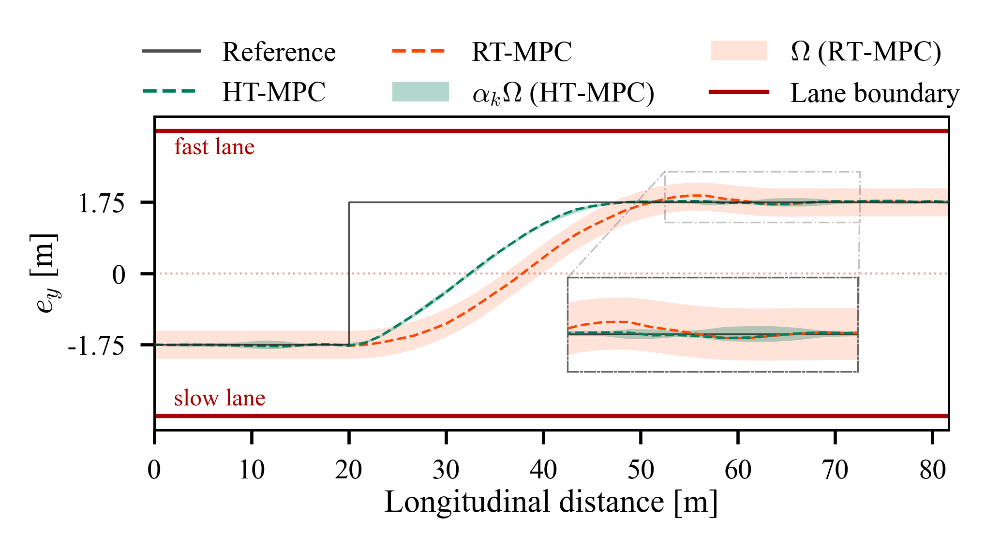
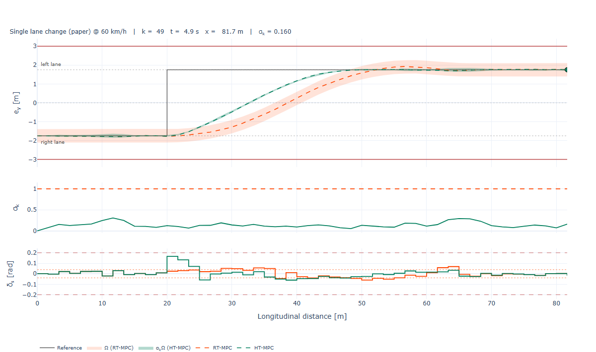

# Homothetic Tube MPC with Closed-Form Scaling — Lane-Change Case Study

Companion code for

> **Homothetic Tube MPC with Closed-Form Scaling for Uncertain Linear Systems**
> Milad Banitalebi Dehkordi, Manas Mejari and Dario Piga
> *(submitted)*


| File | Purpose |
|---|---|
| `LatVeh_Benchmark.ipynb` | **Paper figure** — lateral single-track model, lane change at constant speed; produces `fig_lane_change_comparison_alt.png` |
| `LatVeh_Interactive.ipynb` | **Interactive playground** — the same method (its first code cell is a verbatim copy of the benchmark), with the manoeuvre and the uncertainty bounds as controls and the paper figure drawn as an animation |
| `Carla_recording.mp4` | **Video** — the paper's lane change performed by HT-MPC in the CARLA simulator |
| `app.py` | The same playground as a web app (`streamlit run app.py`); loads the method from the notebook |
| `requirements.txt` | Open-source dependencies (no commercial solver needed) |



## The controller in CARLA

The lane change of the paper, driven by HT-MPC in the CARLA simulator (Lincoln MKZ at a
constant 60 km/h, lateral control by the closed-form homothetic tube MPC, longitudinal speed
held by a PID):

https://github.com/MiladBnit/homothetic-tube-mpc/raw/main/Carla_recording.mp4

<video src="https://github.com/MiladBnit/homothetic-tube-mpc/raw/main/Carla_recording.mp4"
       controls muted playsinline width="640"></video>

If the player above does not appear, open [`Carla_recording.mp4`](Carla_recording.mp4) —
GitHub shows a player on the file page.

## Try it in your browser

[](https://mybinder.org/v2/gh/MiladBnit/homothetic-tube-mpc/main?urlpath=lab/tree/LatVeh_Interactive.ipynb)

**Binder** runs the notebook itself — no install, no account. Click the badge, wait for the
session to start (a few minutes the first time after a change, then under a minute), run all
cells, and the controls appear under the collapsed method cell.

<!-- After deploying on share.streamlit.io, put the app URL here:
[](https://YOUR-APP.streamlit.app)
-->

**`app.py`** is the same playground as a web app, with the controls in a sidebar and no code
in sight. Run it locally with `streamlit run app.py`, or deploy it for free on
[Streamlit Community Cloud](https://share.streamlit.io) (*New app* → this repository → main
file `app.py`). It does not reimplement anything: at start-up it executes the method cell of
`LatVeh_Interactive.ipynb`, so the app, the notebook and the paper's benchmark cannot drift
apart.

## Try it locally

```bash
pip install -r requirements.txt
jupyter lab LatVeh_Interactive.ipynb     # the notebook, with the controls
streamlit run app.py                     # or the same thing as a web app
```

In the notebook, run all cells: the controls appear right under the (collapsed) method cell,
at the top. Choose the manoeuvre (single lane change, slalom, or your own piecewise-constant
reference), the simulation length, the speed and the two uncertainty bounds; press **Run**
(~1 s) and the animation plays by itself.



*The figure the playground produces (here with the optional $\alpha_k$ and $\delta_s$ panels):
the two trajectories with the cross-sections each scheme uses to tighten the current step.
HT-MPC steers up to 0.166 rad, RT-MPC is confined to the rigid margin of 0.039 rad (dotted).*

Larger bounds mean a larger $\Omega$, more tightening and less steering left to the nominal
input. The rigid scheme runs out of steering first: around $\overline{\Delta v} = 0.35$ m/s,
at 45 km/h, or above 85 km/h, **RT-MPC's QP becomes infeasible while HT-MPC still completes
the lane change**; a little further and no design exists at all.

Python ≥ 3.10. All problems are modelled in [CVXPY](https://www.cvxpy.org) and solved with
open-source solvers (Clarabel, with OSQP as fallback, and SCS for the offline SDP); no MOSEK
or Gurobi licence is required.

## Reproducing the paper figure

Run `LatVeh_Benchmark.ipynb` top to bottom. All random draws are seeded, so the figure is
regenerated exactly (up to solver tolerances).

## License

MIT — see `LICENSE`.
