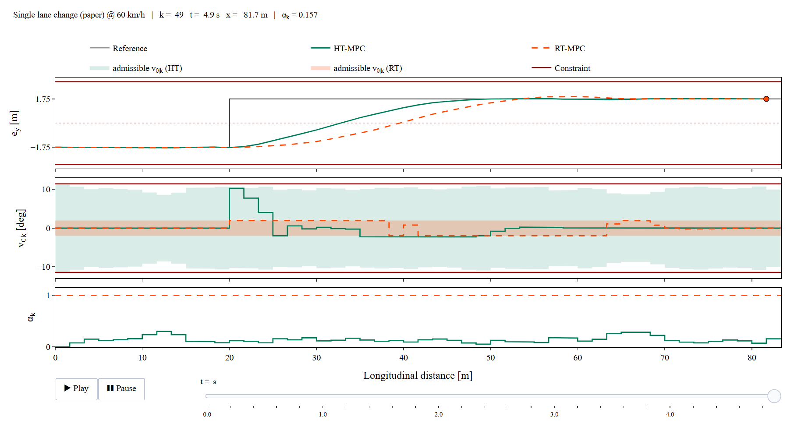
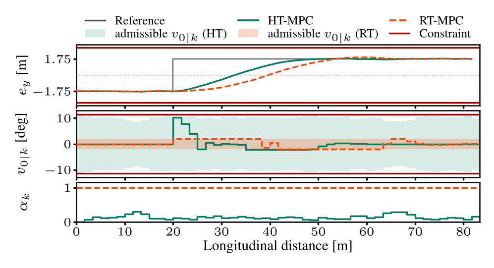

# Homothetic Tube MPC at the Computational Cost of Rigid Tube MPC

**Homothetic Tube MPC at the Computational Cost of Rigid Tube MPC**
Milad Banitalebi Dehkordi, Manas Mejari and Dario Piga — *submitted*

## ▶ [Open the interactive app](https://homothetic-tube-mpc-m2tzxs7zpx8minf6q2znzt.streamlit.app/)

Pick a lane-change manoeuvre, set the speed and the two uncertainty bounds, and watch the
paper's figure being drawn for both controllers. Nothing to install.

[](https://homothetic-tube-mpc-m2tzxs7zpx8minf6q2znzt.streamlit.app/)

*The slalom at the paper's bounds: RT-MPC's QP becomes infeasible at the second lane change
($k = 25$), HT-MPC completes the manoeuvre.*

**HT-MPC** (proposed) and **RT-MPC** (rigid tube) solve the *same* QP, with the same RPI
ellipsoid $\Omega$, the same terminal cost and the same terminal set. The only difference is
the constraint tightening: HT-MPC scales it by the measured $\alpha_k = \|e_k\|_{P^{\star-1}}$
through the closed-form sequence $\alpha_{j|k}$, RT-MPC always uses $\alpha_{j|k} \equiv 1$.
The uncertainty is given by bounds: a speed error $|\Delta v_x| \le \overline{\Delta v}$
(1 km/h around 60 km/h in the paper; the simulated vehicle drives at the worst case
$v_{x0} + \overline{\Delta v}$) and an additive disturbance $w_k$ in an ellipsoid.

Tighten the bounds and the rigid scheme runs out of steering first. In the slalom this happens
already at the paper's bounds, and in the single lane change at
$\overline{\Delta v} = 1.25$ km/h or at 45 or 80 km/h: **RT-MPC's QP becomes infeasible while
HT-MPC still completes the manoeuvre**.

## The controller in CARLA

The lane change of the paper, driven by HT-MPC in the CARLA simulator — a Lincoln MKZ at a
constant 60 km/h, lateral control by the closed-form homothetic tube MPC, longitudinal speed
held by a PID:

<video src="https://github.com/MiladBnit/homothetic-tube-mpc/raw/main/Carla_recording.mp4"
       controls muted playsinline width="640"></video>

If the player does not appear, open [`Carla_recording.mp4`](Carla_recording.mp4).

## In this repository

| | |
|---|---|
| [`app.py`](app.py) | the interactive app; it executes the method cell of the notebook instead of reimplementing it |
| [`LatVeh_Interactive.ipynb`](LatVeh_Interactive.ipynb) | the same playground as a notebook, with the method in one collapsed cell |
| [`LatVeh_Benchmark.ipynb`](LatVeh_Benchmark.ipynb) | the paper's case study and figure; also compares the proposed closed-form scaling against the baseline homothetic scheme of Raković et al. (2012), whose scalings are decision variables |



Top: lateral position. Middle: nominal steering $v_{0|k}$ with the set each scheme admits for
it at the current step ($H_u v \le h_u - \alpha_k s_u$ for HT-MPC, $H_u v \le h_u - s_u$ for
RT-MPC) and the physical limit. Bottom: the scale $\alpha_k$. With the default (paper) bounds
the app and the notebook reproduce this run exactly: closed-loop cost 1494.3 for HT-MPC
against 2347.9 for RT-MPC, a 36.4 % reduction.

On the same run, the baseline homothetic scheme with optimised scalings gives the same closed
loop as the closed-form scaling (relative cost difference below $10^{-7}$). The baseline,
however, solves an SOCP with $N+1$ extra variables. The proposed scheme solves a QP of exactly
the size of RT-MPC's. `LatVeh_Benchmark.ipynb` prints the solver times of all three.

## Running it yourself

```bash
pip install -r requirements.txt
streamlit run app.py                     # the app
jupyter lab LatVeh_Interactive.ipynb     # or the notebook
```

Python ≥ 3.10. Everything is modelled in [CVXPY](https://www.cvxpy.org) and solved with
open-source solvers — Clarabel, OSQP as fallback, SCS for the offline SDP. No commercial
licence is required.

## License

MIT — see [`LICENSE`](LICENSE).
